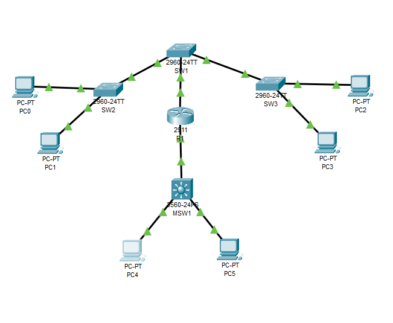
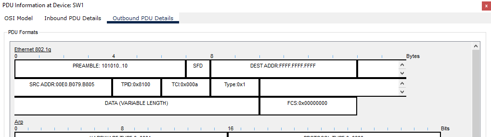

# Отчет по лабораторной работе №3
**Тема:** VLAN, маршрутизация между VLAN
**Выполнил:** Канайкин А. А., гр. 409 

## Топология



## Ответы на вопросы

### Часть 2: Базовая конфигурация VLAN

**Вопрос 1.** Приведите вывод команды `show vlan brief` на SW2. Какие VLAN есть на коммутаторе? Приведите вывод `show vlan id 10` на SW2. Какие интерфейсы в VLAN10? Приведите вывод `show interfaces trunk` на SW1.

**Ответ:** На SW2 созданы VLAN 10 (STUDENTS), 20 (TEACHERS) и 99 (NATIVE). В VLAN 10 находится интерфейс Fa0/1. На SW1 магистральными являются порты Gi0/1, Fa0/23 и Fa0/24, они пропускают VLAN 10 и 20, а Native VLAN равна 99.

```text
SW2# show vlan brief
VLAN Name                             Status    Ports
---- -------------------------------- --------- -------------------------------
1    default                          active    Fa0/3, Fa0/4, Fa0/5, Fa0/6
                                                Fa0/7, Fa0/8, Fa0/9, Fa0/10
                                                Fa0/11, Fa0/12, Fa0/13, Fa0/14
                                                Fa0/15, Fa0/16, Fa0/17, Fa0/18
                                                Fa0/19, Fa0/20, Fa0/21, Fa0/22
                                                Fa0/23, Gi0/1, Gi0/2
10   STUDENTS                         active    Fa0/1
20   TEACHERS                         active    Fa0/2
99   NATIVE                           active    
1002 fddi-default                     active    
1003 token-ring-default               active    
1004 fddinet-default                  active    
1005 trnet-default                    active    

SW2# show vlan id 10
VLAN Name                             Status    Ports
---- -------------------------------- --------- -------------------------------
10   STUDENTS                         active    Fa0/1

VLAN Type  SAID       MTU   Parent RingNo BridgeNo Stp  BrdgMode Trans1 Trans2
---- ----- ---------- ----- ------ ------ -------- ---- -------- ------ ------
10   enet  100010     1500  -      -      -        -    -        0      0
SW2#

SW1# show interfaces trunk
Port        Mode             Encapsulation  Status        Native vlan
Fa0/23      on               802.1q         trunking      99
Fa0/24      on               802.1q         trunking      99
Gig0/1      on               802.1q         trunking      99

Port        Vlans allowed on trunk
Fa0/23      10,20
Fa0/24      10,20
Gig0/1      10,20

Port        Vlans allowed and active in management domain
Fa0/23      10,20
Fa0/24      10,20
Gig0/1      10,20

Port        Vlans in spanning tree forwarding state and not pruned
Fa0/23      10,20
Fa0/24      10,20
Gig0/1      10,20
```

**Вопрос 2.** Изучите заголовок Ethernet кадра в Inbound и Outbound PDU Details. Чем они отличаются? Приложите скриншот заголовка Ethernet из Outbound PDU Details, обведите на нём 802.1q tag. Чему равно значение поля TCI? Переведите его из шестнадцатеричной системы (HEX) в десятичную (DEC).

**Ответ:** Inbound PDU (кадр, приходящий на порт доступа коммутатора от компьютера) **не имеет тега 802.1Q**. Outbound PDU (кадр, уходящий из коммутатора в магистральный канал) **содержит тег 802.1Q**, так как коммутатор добавляет его для передачи информации о VLAN через транк. 

Поле TCI (Tag Control Information) содержит VLAN ID. Для VLAN 10 значение TCI в шестнадцатеричной системе (HEX) равно **`0x000A`**, что в десятичной системе (DEC) соответствует **`10`**.



**Вопрос 3.** Коммутаторы рассылают широковещательные кадры во все свои интерфейсы, кроме того, на котором его получили. В каких VLAN находятся PC0 и PC1. Почему SW2 не отправил ARP Request в сторону PC1?

**Ответ:** PC0 находится в **VLAN 10** (STUDENTS), а PC1 — в **VLAN 20** (TEACHERS). 

SW2 не отправил ARP Request в сторону PC1, потому что **широковещательный трафик ограничен пределами одного VLAN**. Коммутатор рассылает широковещательные кадры только в те порты, которые принадлежат тому же VLAN, что и порт-источник. Поскольку PC1 находится в другом VLAN (20), ARP-запрос из VLAN 10 не выходит за его пределы и не достигает порта PC1. Для связи между PC0 и PC1 (разные VLAN) уже требуется маршрутизатор.

**Вопрос 4.** Приведите вывод команды `ping` между PC0 и PC1. Приведите вывод команды `show ip interface brief` на R1. Приведите вывод команды `show mac address-table` на SW1. Найдите в таблице MAC-адрес маршрутизатора R1. Сколько записей с этим MAC вы видите? Объясните, почему их именно столько, и чем эти записи отличаются друг от друга.

**Ответ:** Пинг между PC0 и PC1 проходит успешно (3 из 4 пакетов, потеря первого пакета связана с ARP). 

В таблице MAC-адресов SW1 можно увидеть **две записи** с MAC-адресом R1 (`0002.1691.9b01`), обе привязаны к интерфейсу `Gig0/1`. Они отличаются **VLAN ID** (одна для VLAN 10, другая для VLAN 20). Это связано с тем, что R1 использует один физический интерфейс для маршрутизации между двумя VLAN (Router-on-a-stick), и коммутатор видит его MAC-адрес в обоих VLAN.

```text
C:\>ping 192.168.20.101

Pinging 192.168.20.101 with 32 bytes of data:

Reply from 192.168.20.101: bytes=32 time=11ms TTL=127
Reply from 192.168.20.101: bytes=32 time=13ms TTL=127
Reply from 192.168.20.101: bytes=32 time=11ms TTL=127
Reply from 192.168.20.101: bytes=32 time=11ms TTL=127

Ping statistics for 192.168.20.101:
    Packets: Sent = 4, Received = 4, Lost = 0 (0% loss),
Approximate round trip times in milli-seconds:
    Minimum = 11ms, Maximum = 13ms, Average = 11ms

R1# show ip interface brief
Interface              IP-Address      OK? Method Status                Protocol
GigabitEthernet0/0     unassigned      YES unset  up                    up      
GigabitEthernet0/0.10  192.168.10.1    YES manual up                    up      
GigabitEthernet0/0.20  192.168.20.1    YES manual up                    up      
GigabitEthernet0/1     10.0.0.1        YES manual up                    up      
GigabitEthernet0/2     unassigned      YES unset  administratively down down    
Vlan1                  unassigned      YES unset  administratively down down    

SW1# show mac address-table
          Mac Address Table
-------------------------------------------
Vlan    Mac Address       Type        Ports
----    -----------       --------    -----
  10    0002.1691.9b01    DYNAMIC     Gig0/1
  10    000d.bd64.6618    DYNAMIC     Fa0/24
  10    0010.118e.b28c    DYNAMIC     Fa0/24
  10    00e0.b079.b805    DYNAMIC     Fa0/23
  20    0002.1691.9b01    DYNAMIC     Gig0/1
  20    0002.16d7.adbc    DYNAMIC     Fa0/23
  20    000d.bd64.6618    DYNAMIC     Fa0/24
```

**Вопрос 5.** Приложите результаты выполнения `ping`. Приложите вывод команд `show ip interface brief` и `show ip route` на MSW1.

**Ответ:** Пинг между PC4 и PC5 (внутри MSW1) проходит успешно — это подтверждает работу Inter-VLAN Routing на многоуровневом коммутаторе. Пинг между PC4 и PC0 (сквозная маршрутизация через R1) также проходит успешно после добавления статических маршрутов. На MSW1 включен `ip routing`, SVI интерфейсы подняты, статические маршруты прописаны.

```text 
C:\>ping 192.168.40.101

Pinging 192.168.40.101 with 32 bytes of data:

Request timed out.
Reply from 192.168.40.101: bytes=32 time<1ms TTL=127
Reply from 192.168.40.101: bytes=32 time<1ms TTL=127
Reply from 192.168.40.101: bytes=32 time<1ms TTL=127

Ping statistics for 192.168.40.101:
    Packets: Sent = 4, Received = 3, Lost = 1 (25% loss),
Approximate round trip times in milli-seconds:
    Minimum = 0ms, Maximum = 0ms, Average = 0ms

C:\>ping 192.168.10.101

Pinging 192.168.10.101 with 32 bytes of data:

Request timed out.
Reply from 192.168.10.101: bytes=32 time=11ms TTL=126
Reply from 192.168.10.101: bytes=32 time=12ms TTL=126
Reply from 192.168.10.101: bytes=32 time=13ms TTL=126

Ping statistics for 192.168.10.101:
    Packets: Sent = 4, Received = 3, Lost = 1 (25% loss),
Approximate round trip times in milli-seconds:
    Minimum = 11ms, Maximum = 13ms, Average = 12ms

MSW1# show ip interface brief
Interface              IP-Address      OK? Method Status                Protocol 
FastEthernet0/1        unassigned      YES unset  up                    up 
FastEthernet0/2        unassigned      YES unset  up                    up 
FastEthernet0/3        unassigned      YES unset  down                  down 
FastEthernet0/4        unassigned      YES unset  down                  down 
FastEthernet0/5        unassigned      YES unset  down                  down 
FastEthernet0/6        unassigned      YES unset  down                  down 
FastEthernet0/7        unassigned      YES unset  down                  down 
FastEthernet0/8        unassigned      YES unset  down                  down 
FastEthernet0/9        unassigned      YES unset  down                  down 
FastEthernet0/10       unassigned      YES unset  down                  down 
FastEthernet0/11       unassigned      YES unset  down                  down 
FastEthernet0/12       unassigned      YES unset  down                  down 
FastEthernet0/13       unassigned      YES unset  down                  down 
FastEthernet0/14       unassigned      YES unset  down                  down 
FastEthernet0/15       unassigned      YES unset  down                  down 
FastEthernet0/16       unassigned      YES unset  down                  down 
FastEthernet0/17       unassigned      YES unset  down                  down 
FastEthernet0/18       unassigned      YES unset  down                  down 
FastEthernet0/19       unassigned      YES unset  down                  down 
FastEthernet0/20       unassigned      YES unset  down                  down 
FastEthernet0/21       unassigned      YES unset  down                  down 
FastEthernet0/22       unassigned      YES unset  down                  down 
FastEthernet0/23       unassigned      YES unset  down                  down 
FastEthernet0/24       unassigned      YES unset  down                  down 
GigabitEthernet0/1     10.0.0.2        YES manual up                    up 
GigabitEthernet0/2     unassigned      YES unset  down                  down 
Vlan1                  unassigned      YES unset  administratively down down 
Vlan30                 192.168.30.1    YES manual up                    up 
Vlan40                 192.168.40.1    YES manual up                    up

MSW1# show ip route
Codes: C - connected, S - static, I - IGRP, R - RIP, M - mobile, B - BGP
       D - EIGRP, EX - EIGRP external, O - OSPF, IA - OSPF inter area
       N1 - OSPF NSSA external type 1, N2 - OSPF NSSA external type 2
       E1 - OSPF external type 1, E2 - OSPF external type 2, E - EGP
       i - IS-IS, L1 - IS-IS level-1, L2 - IS-IS level-2, ia - IS-IS inter area
       * - candidate default, U - per-user static route, o - ODR
       P - periodic downloaded static route

Gateway of last resort is not set

     10.0.0.0/30 is subnetted, 1 subnets
C       10.0.0.0 is directly connected, GigabitEthernet0/1
S    192.168.10.0/24 [1/0] via 10.0.0.1
S    192.168.20.0/24 [1/0] via 10.0.0.1
C    192.168.30.0/24 is directly connected, Vlan30
C    192.168.40.0/24 is directly connected, Vlan40
```